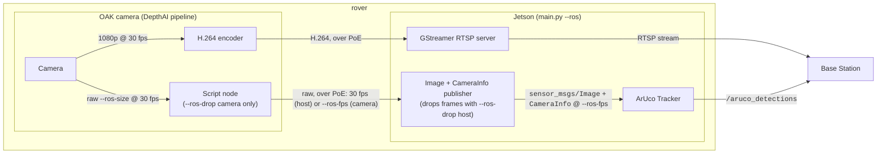

# ArUco image bridge

Publishes a low-rate raw image and matching `CameraInfo` from the Luxonis cameras so the ArUco tracker (`ros_aruco_opencv`) can detect markers. Enable it with `main.py --ros`; the options and topics are in [`luxonis_scripts/README.md`](../README.md).



The ArUco output always leaves the camera's image pipeline at the encoder rate (30 FPS); requesting it at `--ros-fps` directly stalls the camera (see [Troubleshooting](#camera-stops-after-the-first-frame-bw-shows-0-fps)). `--ros-drop` picks where the extra frames are dropped: on the Jetson (`host`, the default; the Script node is not created) or on the camera (`camera`). The CameraInfo comes from the calibration stored on the camera, read once at startup.

## Status

Validated on the rover (Jetson + OAK-D Pro PoE at `10.240.0.67`) in `oakd_rgb` mode with `--ros-encoding mono8 --ros-size 640x480` and the default `--ros-drop host`: RTSP stays at 30 FPS, `/oakd/rgb/image_raw` publishes at 5 Hz, and the tracker detects markers.

Not yet validated on the rover: `--ros-drop camera`, the FFC cameras, and `bgr8` at 1280x720 over PoE (see [Bandwidth](#bandwidth)).

## Setup on the Jetson

Once per checkout.

**Tracker.** `ros_aruco_opencv` needs the build fixes from [#96](https://github.com/space-concordia-robotics/robot-repo-ros2/pull/96), which are not on `main` yet. Build it as Release: the repository's default `RelWithDebInfo` build type compiles it with AddressSanitizer, and the tracker then fails to load with `undefined symbol: __asan_option_detect_stack_use_after_return`.

```bash
cd <workspace>
colcon build --packages-up-to ros_aruco_opencv launch_util --mixin release
```

**Compressed image transport.** Needed to view the debug image from another machine (step 5). Without it, `republish` aborts with `class image_transport/compressed_pub ... does not exist`.

```bash
sudo apt install ros-jazzy-image-transport-plugins
ros2 run image_transport list_transports   # lists image_transport/compressed
```

**Camera virtualenv.** From `luxonis_scripts/`. PyGObject is built from source on the Jetson and needs the apt packages first; without them `pip` aborts and installs nothing, OpenCV included.

```bash
sudo apt install -y pkg-config cmake python3-dev libcairo2-dev libgirepository-2.0-dev
python3 -m venv venv
source venv/bin/activate        # venv/bin/activate.fish in fish
pip install -r requirements.txt
```

`requirements.txt` pins `depthai==3.6.1` and `numpy<2`; an existing venv with newer versions is downgraded by the install. `numpy` 2 breaks `cv_bridge`. It also installs `PyYAML`, which `rclpy` imports: the venv does not see the apt `python3-yaml`, and without it `--ros` exits with `No module named 'yaml'`. If an existing venv shows that error, run `pip install -r requirements.txt` again.

`depthai` 3.9.0 was tried and did not fix the [lower-rate stall](#camera-stops-after-the-first-frame-bw-shows-0-fps), so the pin stays at 3.6.1. To try another version, use a separate venv (`python3 -m venv venv-test`) so the working one is untouched; nothing is written to the camera unless you flash its bootloader.

**Unit tests.** From `luxonis_scripts/`, with the virtualenv active:

```bash
pip install pytest
PYTEST_DISABLE_PLUGIN_AUTOLOAD=1 python -m pytest test/aruco_image_bridge -q
```

`PYTEST_DISABLE_PLUGIN_AUTOLOAD=1` stops pytest from loading ROS's `launch_testing` plugin when ROS is sourced. That plugin needs packages the virtualenv does not have, and fails to load on pytest 9.

## Running ArUco detection on the rover

All commands run on the Jetson. Open one terminal per step (tmux panes work well).

**1. Source ROS and the workspace** in every terminal:

```bash
source /opt/ros/jazzy/setup.bash
source <workspace>/install/setup.bash   # the colcon workspace that contains this repository
```

Only `main.py` and the `aruco_image_bridge` scripts need the camera virtualenv; run the `ros2` commands without it.

**2. Start the camera with the ROS output.** From `luxonis_scripts/`, with the camera virtualenv active:

```bash
python3 main.py --mode oakd_rgb -d 10.240.0.67 --ros --ros-cameras RGB --ros-encoding mono8 --ros-size 640x480
```

`--ros-cameras` must name a camera that the mode actually runs (`RGB` for `oakd_rgb`, `FRONT` etc. for the FFC modes), otherwise nothing is published. Wait for the `ROS output RGB: ...` and `RGB calibration: ...` lines, then type `bw` at the `>` prompt: the stream should report about 30 FPS. `bw` printing `no traffic` means the camera stopped (see [Troubleshooting](#camera-stops-after-the-first-frame-bw-shows-0-fps)).

Add `--ros-drop camera` to drop the extra ArUco frames on the camera instead of on the Jetson, which keeps them off the PoE link (not yet validated on the rover; see [Bandwidth](#bandwidth)). If RTSP or the image topic stops with it, run again without it.

A warning that thin-prism/tilt coefficients were dropped is expected on cameras whose calibration has them: the OAK reports 14 distortion coefficients, and ROS `rational_polynomial` carries the first 8. The dropped terms are small and mostly matter near the image edges.

**3. Check the topics** in a second terminal:

```bash
ros2 topic hz /oakd/rgb/camera_info   # ~5 Hz
ros2 topic hz /oakd/rgb/image_raw     # ~5 Hz
```

**4. Start the tracker** on the same camera. The launch file defaults to the front FFC camera (`/ffc/front/image_raw`), so the topic must be given for the OAK-D:

```bash
ros2 launch rover-bringup/launch/aruco_tracker.py cam_base_topic:=/oakd/rgb/image_raw
```

It logs `First camera info retrieved.` once it is receiving data. Defaults are `marker_dict:=4X4_50` and `marker_size:=0.15` (competition markers); override them on the same command line if needed.

**5. Look at the detections.**

```bash
# just the detected markers, without the header and rejected candidates
ros2 topic echo /aruco_detections --field markers
```

`/oakd/rgb/image_raw` stays raw: it never leaves the Jetson, and JPEG artifacts would blur the marker corners. Only what goes to the base station needs compressing.

The annotated image (marker outlines, axes and large yellow IDs) is on `/aruco_tracker/debug` as raw `bgr8`, about 0.9 MB per frame. The tracker only draws it while something subscribes. Over Wi-Fi most raw frames are dropped or arrive late, so republish it as JPEG on the Jetson:

```bash
ros2 run image_transport republish --ros-args \
  -p in_transport:=raw -p out_transport:=compressed \
  -r in:=/aruco_tracker/debug \
  -r out/compressed:=/aruco_tracker/debug_view/compressed
```

Remap `out/compressed`, not `out`: the republisher appends `/compressed` before applying remaps, so `-r out:=...` leaves the output on `/out/compressed`. Positional `raw compressed` arguments are not used on Jazzy. The republisher only subscribes to `/aruco_tracker/debug` while something subscribes to its output, so leaving it running costs nothing when nobody is viewing.

Then on the base station:

```bash
ros2 topic hz /aruco_tracker/debug_view/compressed   # ~5 Hz
ros2 run rqt_image_view rqt_image_view
```

and pick `/aruco_tracker/debug_view` with the `compressed` transport in the dropdown. Passing `/aruco_tracker/debug_view/compressed` on the command line subscribes to it as a raw image and only prints a warning. The tracker-to-debug latency on the Jetson is about 70 ms (`ros2 topic delay /aruco_tracker/debug`); the 5 Hz `--ros-fps` adds up to 200 ms of staleness on top.

Marker poses are in the camera's optical frame (`oakd_rgb_camera_optical_frame`): x right, y down, z out of the lens, in meters. The tracker also broadcasts a TF frame per marker (`marker_<id>`).

### Known limitations

- The camera optical frames are not in the URDF yet, so marker poses cannot be transformed to `base_link` through TF.
- Typing `q` in `main.py` ends with `NameError: name 'session' is not defined`. The cameras have already stopped by then; the error is harmless.

## Troubleshooting

### Bandwidth

The ArUco output is produced on the camera at the encoder rate (30 FPS). With the default `--ros-drop host` it is throttled to `--ros-fps` on the Jetson, so the PoE link carries the full rate of raw frames on top of the H.264 stream:

| `--ros-encoding` / `--ros-size` | Raw ArUco traffic at 30 FPS (`host`) | At 5 FPS (`camera`) |
|---|---|---|
| `mono8` 640x480 | ~74 Mbit/s | ~12 Mbit/s |
| `mono8` 1280x720 | ~220 Mbit/s | ~37 Mbit/s |
| `bgr8` 1280x720 | ~660 Mbit/s | ~110 Mbit/s |

Use `mono8`; the tracker works on grayscale anyway, and its debug image is converted back to color for display.

`--ros-drop camera` drops the extra frames on the camera with a DepthAI `Script` node, which forwards one frame in every `30 / --ros-fps` (rounded). The camera still produces the ArUco output at 30 FPS, so the stall below does not occur, but only `--ros-fps` worth of raw frames crosses the link. Sending raw frames is known to load the OAK-D Pro PoE's network processor ([depthai-core#423](https://github.com/luxonis/depthai-core/issues/423)), so this should also lighten the camera. The Script node's input holds one frame and never blocks, so a slow script drops frames instead of stalling RTSP. Not yet validated on the rover.

### Camera stops after the first frame (`bw` shows 0 FPS)

Requesting the ArUco output at its own lower rate (`fps=ros_config.fps` in `add_aruco_output`) next to the 30 FPS encoder output makes the OAK-D deliver one frame and then nothing on any output, RTSP included; `bw` prints `no traffic`. Reproduced on `depthai` 3.6.1 and 3.9.0. The cause is not known; the release notes up to 3.9.0 mention no fix.

`add_aruco_output` in `main.py` therefore requests the camera rate, and the extra frames are dropped by `ArucoFrameSink` on the Jetson or by the Script node on the camera (`--ros-drop`). If the stall happens again, compare with a run without `--ros`: if that one runs at 30 FPS, the ArUco output is the cause; then try the other `--ros-drop` value.

### Measuring load

To compare settings (`--ros-drop`, `--ros-size`, tracker parameters), keep the scene fixed (marker at a fixed distance, camera still, same lighting), run each setting for about a minute, and change one thing at a time.

- **Camera:** `bw` at the `main.py` prompt shows Mbit/s and FPS per stream. `main.py` does not report the camera's own CPU load.
- **Jetson CPU per process** (`sudo apt install sysstat`; fish syntax): `pidstat -u -p (pgrep -d, -f 'main.py|aruco_tracker|republish') 5`. Whole board: `sudo tegrastats --interval 1000`.
- **Rates and latency:** `ros2 topic hz /oakd/rgb/image_raw` and `ros2 topic hz /aruco_detections` should both be about `--ros-fps`; `ros2 topic delay /aruco_detections` is the time from capture to detection.
- **Time per frame in the tracker:** it logs it at debug level. Start it directly instead of through the launch file:

  ```bash
  ros2 run ros_aruco_opencv aruco_tracker_autostart --ros-args -r __node:=aruco_tracker \
    --params-file (ros2 pkg prefix ros_aruco_opencv)/share/ros_aruco_opencv/config/aruco_tracker.yaml \
    -p cam_base_topic:=/oakd/rgb/image_raw -p marker_size:=0.15 \
    --log-level aruco_tracker:=debug
  ```

  (`$(ros2 pkg prefix ros_aruco_opencv)` in bash.)
- **Detection quality:** `ros2 topic echo /aruco_detections --field markers`. A faster setting only helps if the marker is still found on nearly every frame.

The tracker parameters that cost the most are in `aruco/ros-aruco-opencv/config/aruco_tracker.yaml`: the adaptive threshold window range (`adaptiveThreshWinSizeMin/Max/Step`, three passes by default), `cornerRefinementMethod: 2` (contour, the slowest), and `useAruco3Detection` (faster, mainly with `minMarkerLengthRatioOriginalImg` above 0). Each trades robustness or accuracy for speed.

### Segmentation fault at `Connecting to OAKD`

A PoE OAK reboots for 10–30 s after the previous connection closes, and DepthAI can crash instead of raising if it connects during that time. Wait until the camera is listed before restarting `main.py`:

```bash
python3 -c "import depthai as dai; print(dai.Device.getAllAvailableDevices())"
```

### Tracker stays at `Waiting for first camera info...`

The tracker listens on `cam_base_topic` and its sibling `camera_info`. Check that it matches the camera that is publishing (step 4), and that `ros2 topic hz` on that `camera_info` topic shows data.

### Topics are listed but `ros2 topic hz` shows nothing

`ros2 topic list` also lists topics that only have subscribers (for example the tracker's). Check the publisher with `ros2 topic info -v /oakd/rgb/image_raw` and the camera with `status` / `bw` at the `main.py` prompt. `status` only says whether the session thread is alive; an error inside it is not printed, so 0 FPS in `bw` is the signal that the camera stopped.

### Debug image annotations are gray

Fixed in `ros_aruco_opencv`: with `mono8` input the debug image is now converted to `bgr8` before drawing, and marker IDs are drawn larger. Rebuild the tracker after pulling (`colcon build --packages-select ros_aruco_opencv --mixin release`).

### Debug image lags on the base station

Viewing raw `/aruco_tracker/debug` over Wi-Fi: use the compressed republish from step 5. To tell the network from the pipeline, run `ros2 topic delay /aruco_tracker/debug` on the Jetson (about 70 ms is normal). The same command on the base station is only meaningful if both clocks are synchronized; check the offset with `ssh <jetson> date +%s.%N; date +%s.%N`.

### Tracker crashes with `undefined symbol: __asan_...`

The tracker was built with the default `RelWithDebInfo` build type, which enables AddressSanitizer. Rebuild it as Release:

```bash
rm -rf build/ros_aruco_opencv install/ros_aruco_opencv
colcon build --packages-up-to ros_aruco_opencv launch_util --mixin release
nm -D install/ros_aruco_opencv/lib/libros_aruco_opencv.so | grep -c asan   # 0
```

### `Searched, but no actual device found` / camera not found

Check that the camera is reachable and listed:

```bash
ping -c 3 10.240.0.67
python3 -c "import depthai as dai; print(dai.Device.getAllAvailableDevices())"
```

If it is listed with state `X_LINK_BOOTED`, another process already holds it (an autostarted camera service or a leftover `main.py`); stop that process first. If it does not answer `ping`, check the PoE injector's power LED and the Ethernet link LEDs on both ends, and that the Jetson has an address on the `10.240.0.x` network (`ip -br addr`).

## Synthetic test (no camera)

With ROS and the workspace sourced, one command per terminal; the `python3 -m aruco_image_bridge...` commands also need the camera virtualenv:

```bash
# from luxonis_scripts/: a fake camera publishing marker 7
python3 -m aruco_image_bridge.publish_test_images --dictionary 4X4_50
# from the repository root: the tracker on the fake topic
ros2 launch rover-bringup/launch/aruco_tracker.py cam_base_topic:=/test/camera/front/image_raw
# from luxonis_scripts/: check the stream, then the detections
python3 -m aruco_image_bridge.check_test_stream --dictionary 4X4_50
ros2 topic echo /aruco_detections --once
```

Expect `PASS` from the checker and `id: 7` at `pose.position.z` ≈ 0.603 (800 × 0.15 / 199 px). `--encoding mono8` on both tools tests grayscale. The tracker's dictionary cannot change while it runs, so restart both to try another one; a 5X5 marker shown to a `4X4_50` tracker must give `markers: []`.
